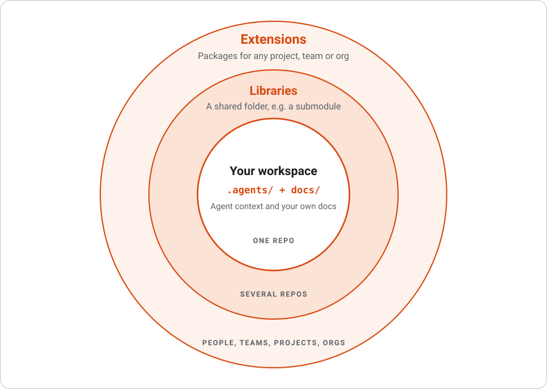

# Open Forge

Open Forge is a Markdown framework that tells coding agents which of your project's rules, docs and decisions to read for each task, and keeps what they learn for the next one.

One long `AGENTS.md` gives every task every rule. Open Forge replaces it with a loader and one short catalogue per folder, so each task reads only the routes it needs. E.g. a rule tagged `LoadNow` with `applyTo: ["src/export/**"]` applies only to tasks that change export code.

Your own documents can stay where they are. The framework and the agents' notes live in one context folder, `.agents` by default. A folder your team writes in, such as `docs/team`, can be registered as a route: agents find its documents through the loader, and the CLI keeps its catalogue current. [Your own docs](#your-own-docs) shows how, and how to tell agents which documents they can rely on.

The design comes from an idea I call **Adaptive Context Engineering (ACE)**. An agent doesn't need to know everything, but it does need to know where everything is.

[](https://www.npmjs.com/package/@thelithiumforge/open-forge)
[](https://github.com/TheLithiumForge/open-forge/actions/workflows/build.yml)
[](https://thelithiumforge.github.io/open-forge/)
[](LICENSE)

## Requirements

To use Open Forge, you need:

- An agent tool that reads `AGENTS.md` or `CLAUDE.md`.
- Node.js 22.18 or later, if you install the CLI from npm. The native release and the manual copy need no Node.js.

## Install

Install the CLI from npm:

```sh
npm install -g @thelithiumforge/open-forge@beta
```

The CLI is optional. Everything it does, you can do by editing files. The other install methods are below.

### From a GitHub release

Download `open-forge-<version>-<platform>.tar.gz` from the [releases page](https://github.com/TheLithiumForge/open-forge/releases). The platform is `linux-x64`, `linux-arm64`, `osx-x64`, `osx-arm64`, `win-x64` or `win-arm64`. Check it against the release's `SHA256SUMS` and extract it. For example, on Linux:

```sh
sha256sum --check --ignore-missing SHA256SUMS
tar -xzf open-forge-<version>-linux-x64.tar.gz
```

The archive holds a single `open-forge` executable (`open-forge.exe` on Windows) and its license. Put it on your `PATH`, or keep it in your repository, e.g. as `tools/open-forge`, and run it as `./tools/open-forge`.

### From source

Clone this repository and follow the [local setup guide](docs/development.md#link-the-native-cli-locally) to build and link the CLI.

### Manual copy

The Framework is complete in [src/open-forge](src/open-forge/), so you can copy it without the CLI. A manual copy gives you Full Core, which you can adapt by hand:

```sh
git clone https://github.com/TheLithiumForge/open-forge.git
cp -R open-forge/src/open-forge/.agents /path/to/your-project/
cat open-forge/src/open-forge/AGENTS.md >> /path/to/your-project/AGENTS.md
```

If your agent tool reads `CLAUDE.md`, append `open-forge/src/open-forge/CLAUDE.md` to your project's `CLAUDE.md` too. If the project already has a `.agents/` folder, merge the two by hand instead of copying over it. For the smallest setup, copy only `.agents/loader.md` and `.agents/README.md`, then replace the loader's `Entries` with `- none - No entries - #Empty` before you add your own links.

## Quick start

The examples use the default context folder, `.agents`. You can choose another one at first installation, as [Context folder](#context-folder) describes.

1. Preview the smallest setup from your project:

   ```sh
   cd /path/to/your-project
   open-forge install --preset minimal --dry-run
   ```

   The plan lists every file it would touch. Minimal writes the loader, a Directives folder for rules agents must follow, a Crystallized Memory folder for accepted knowledge, and a marked Open Forge section in `AGENTS.md` and `CLAUDE.md`. Your existing text in those files stays as it is. It also writes `.agents/README.md`, a short guide that holds the file formats agents follow when they write workspace files. You can delete it.

2. Apply the same selection:

   ```sh
   open-forge install --preset minimal --automatic
   ```

3. Review the result with `git status` and `git diff`, then commit it. A fresh install adds new files, which `git status` lists and `git diff` alone doesn't show. Both folders start empty, so agents read only the loader and two short catalogues until you add something.

4. Point agents at a document you already have:

   ```sh
   open-forge route include CONTRIBUTING.md --description "Contribution rules to follow" --tag LoadNow
   ```

   This adds one line under `## Entries` in `.agents/loader.md`. You can also write it by hand:

   ```markdown
   - [Contribution rules to follow](../CONTRIBUTING.md) - #LoadNow
   ```

   `#LoadNow` means agents read the file before every task.

5. Give your agent a normal task:

   > Explain how this project runs its tests. Follow `AGENTS.md`, and name the files you read.

   Check the answer against your contribution guide. You can stop here.

That's the whole setup. Start with one document you already have, and add rules, Memory or reusable methods when they solve a problem you have. Installing and updating are things you do when you maintain the workspace. Agents don't repeat them at startup. If your agent tool doesn't read `AGENTS.md` on its own, ask it to read that file first.

To try it without touching your checkout, [use a separate clone](https://thelithiumforge.github.io/open-forge/docs/getting-started/installation#try-it-and-undo-a-trial). The [ten-minute guide](https://thelithiumforge.github.io/open-forge/docs/getting-started/ten-minute-guide) walks through adding a rule, keeping a useful fact and finding the context for your next task. Starting something new? The [greenfield demo](https://thelithiumforge.github.io/open-forge/docs/demos/greenfield) gives you a first build request. You don't need to choose a workflow, install Extensions or write a specification first.

## How it works

Every task follows the same path:

```text
You ask for a task
        |
AGENTS.md -> loader
        |
Startup rules + relevant links
        |
Work, keep useful outcomes
```

Each context folder has an `entrypoint`, a short Markdown file named `_{folder-name}.md` that lists what's inside under `Entries`. Startup reads the loader and the entrypoints tagged to load, plus the files their tags or rules require. The rest opens when a task needs it. Reading an entrypoint doesn't open the files it lists.

Scopes keep specialized context with the work it applies to. Put frontend conventions in a frontend scope and database rules in a database scope. A task selects the branches it needs, and a task that spans both follows both on purpose. There's no fixed limit on how many scopes you add or how deep they go. Active context follows the selected routes and their links, so adding knowledge doesn't mean every task reads more of it.

This is ACE. It takes progressive disclosure and spec-driven development and applies them to the workspace itself:

- Progressive disclosure - show the next useful level of detail, not everything at once.
- Spec-driven development - make goals, constraints and expected results clear enough to guide the work and check the result.

A task starts from what you want to achieve. As the work unfolds, the agent pulls in what it needs, such as the relevant architecture, your local conventions or the decision you made last month, and unrelated history stays out. What you learn along the way can become part of the framework, so the next task starts from a better place. Context isn't every file in the repository. It's the knowledge, rules and current state a task needs.

Open Forge works beside your agent tool. Any tool that reads `AGENTS.md` or `CLAUDE.md` can use it. Keep your hooks, custom agents and tools. If you want to define them once for several tools, a translator such as [APM](https://github.com/microsoft/apm) can install them where each tool looks for them.

The [loading guide](https://thelithiumforge.github.io/open-forge/docs/concepts/loading-and-tags) explains the loading tags and file conditions step by step.

## Your own docs

Open Forge keeps two kinds of content apart:

- The main root - the context folder, `.agents` by default. It holds the loader, the Framework's rules and the agents' Memory.
- Outside routes - folders you register, such as `docs/team`. They hold your team's documents, written by hand or with AI help.

```text
AGENTS.md
.agents/           <- main root: loader, rules, Memory
docs/
  team/            <- outside route: your own documents
    _team.md       <- its catalogue
    testing.md
```

### Include a file

`route include <file>` lists one document where it lives, as the [Quick start](#quick-start) shows. The file needs no frontmatter, and the include is read-only by itself. Add `--apply-to "**/*.cs"` to limit it to matching work, or leave the tag off so agents open it only when its description fits the task. Rules you already wrote for other tools work the same way, such as `.cursor/rules/testing.mdc` or `.windsurfrules`. `open-forge route exclude CONTRIBUTING.md` removes the line again and leaves the file alone.

### Include a folder

To maintain a whole folder where it lives, include the folder. For an existing `docs/team` directory, preview the plan, then run it:

```sh
open-forge route include docs/team --dry-run
open-forge route include docs/team
```

At first installation, the install wizard offers the same thing for one folder right after the context-folder question. Press Enter to skip it.

This registers an outside route and lists its catalogue, `docs/team/_team.md`. The command creates the catalogue only when it's missing. From then on, the CLI works inside the folder the same way it works in the main root:

```sh
open-forge route create ./docs/team/testing.md --description "Team testing rules" --tag Testing --dry-run
open-forge index ./docs/team/_team.md --dry-run
```

The loader still decides what loads. `status` and `doctor` report on registered folders, and Install, configure and Update keep your registrations and the loading rules you wrote. [Outside routes](docs/cli.md#outside-routes) covers exact paths, unlisted maintenance and the safety limits.

### Accepted sources

If you keep rules and facts in your own `docs/` folder instead of in `.agents`, include them like any other document. Then say in `AGENTS.md`, outside the marked section, which of them are accepted sources.

The loader asks agents to treat content as accepted only when you agree, or when a source you named for that question says so. Linking, tagging or reading a document doesn't count, and it doesn't give an agent permission to edit it. These are instructions the agent follows, so review its work as usual.

### Context folder

At first installation, `install --main-root <folder>` puts the context files in another absent or empty folder:

```sh
open-forge install --main-root docs/forge --preset minimal --dry-run
```

The wizard asks "Where should Open Forge keep its context files?" before the route choices, and defaults to `.agents`. Skills, settings and ownership stay in `.agents`. `AGENTS.md` and `CLAUDE.md` stay at the workspace root and point to the selected loader. Older CLIs don't support custom roots, and relocating an established installation isn't available yet. See the [context folder reference](docs/cli.md#context-folder).

## Share with your team

Open Forge shares context at three levels. Each level reaches further than the one inside it, and you can stop at any of them.

<p align="center">
  <picture>
    <source media="(prefers-color-scheme: dark)" srcset="src/docusaurus/static/img/integration-levels-dark.svg">
    
  </picture>
</p>

| Level     | Reach                           | What you share                                                               |
| --------- | ------------------------------- | ---------------------------------------------------------------------------- |
| Workspace | One repo                        | The main root for agent context, and outside routes for your team's own docs |
| Library   | Several repos                   | One shared folder, such as a Git submodule, linked into place                |
| Extension | People, teams, projects or orgs | Packages of files that any project installs and then adapts                  |

### Workspace

Everyone who clones the repository gets the main root and its outside routes, so agents and people read the same rules. Your team writes its standards in `docs/` the way it already does, and you decide which of them are accepted sources. Working records can stay on each machine, as [Memory](#memory) describes.

### Library

A Library links a shared folder into place instead of copying its files. The source folder sits inside the workspace, e.g. a Git submodule at `vendor/team-rules` that several repos include. `library attach` projects its files into another place through relative file links:

```sh
open-forge library attach team-rules vendor/team-rules --to docs/team \
  --git-ignore true --allow-path docs/team --allow-path .gitignore --dry-run
```

The links still point to their source, so the projected files always show the shared folder's current content. `library sync` updates the links when source files come and go. `--git-ignore true` keeps the links out of Git, so each checkout recreates its own. `--git-ignore false` commits them. The source files stay read-only input. See [Workspace libraries](docs/cli.md#workspace-libraries).

### Extension

An Extension is a package of files that any project can install and then adapt like its own. The CLI has the first-party catalogue built in, and nothing is fetched from a registry. To share your own standards across teams or organizations, create a package with `open-forge extension create`, keep its catalogue where your teams can get it, and install it with `open-forge extension install <id> --source <catalogue>`. The source catalogue has to be separate from the target workspace. The [Extension guide](docs/extensions.md#create-an-extension) covers the package format. [Extensions](#extensions) lists the first-party packages.

## What you get

Each preset includes the one before it, and each is a useful place to stop:

| You need                                          | Start with                                                |
| ------------------------------------------------- | --------------------------------------------------------- |
| Rules, accepted facts and your existing documents | Minimal, the recommended start                            |
| Work that continues across sessions               | Minimal plus Working Memory                               |
| The usual set for a new project                   | Essentials, which adds patterns, skills and working notes |
| Every built-in folder                             | Full Core                                                 |
| A particular planning or development method       | An [Extension](#extensions)                               |

The presets install these folders:

- Minimal - the loader, the guide for people, the marked host sections, Directives and Crystallized Memory.
- Essentials - Minimal plus Patterns, Skills, and Working and Emerging Memory.
- Full Core - every built-in folder. It gives you 20 Markdown files, including the guide for people and four supporting CLI guides that open when needed.
- Custom - the folders you pick.

No preset installs optional Extensions. Every folder is optional. Memory states need Memory, but they don't need each other. Extensions declare their own dependencies.

Running `open-forge install` with no options starts a short wizard. It recommends Minimal and offers Essentials, Full Core and Custom, with a line on each. To skip the questions, name the preset:

```sh
open-forge install --preset essentials --dry-run
open-forge install --preset essentials
```

The dry run previews that exact selection without asking setup questions. Use `minimal` for the smallest setup and `full-core` for every built-in route. On an installed workspace, a preset or `--frontmatter` choice also needs `--configure`. The [installation guide](https://thelithiumforge.github.io/open-forge/docs/getting-started/installation) explains every choice, and the [CLI reference](docs/cli.md#setup-choices) covers Custom rows and noninteractive configuration.

<details>
<summary>See the Full Core files</summary>

```text
AGENTS.md                         <- tells the agent to read the loader first
CLAUDE.md                         <- the same entry for tools that read CLAUDE.md
.agents/
  loader.md                       <- the reading steps and the list of what agents use
  README.md                       <- a guide and the file formats, safe to delete
  directives/_directives.md       <- required behavior
  guidance/_guidance.md           <- advice for recurring choices
  patterns/_patterns.md           <- reusable shapes for code, files, and documents
  skills/_skills.md               <- native SKILL.md capabilities
  skills/open-forge-cli/SKILL.md  <- how to use the CLI, read before CLI commands
  skills/open-forge-cli/references/
    discovery.md                  <- reading and discovery
    routes.md                     <- route maintenance
    packages.md                   <- Framework and packages
    common.md                     <- shared options and results
  templates/_templates.md         <- copy-ready starting files
  maps/_maps.md                   <- pointers to important local and external sources
  memory/
    _memory.md                    <- what is worth remembering
    working/_working.md           <- temporary state for active work
    emerging/_emerging.md         <- useful, but not settled yet
    crystallized/_crystallized.md <- accepted knowledge that stays current
    archived/_archived.md         <- history that no longer governs current work
```

</details>

The tree shows Full Core with the default `.agents` context folder. Essentials leaves out Guidance, Maps, Templates and Archived Memory. Each installed entrypoint says what its category is for and the rules for using it, then lists what's inside under `Entries`. Apart from the Memory state entrypoints and the `open-forge-cli` Skill, every selected category starts empty. The content comes from your work, or from Extensions you choose.

In Full Core, startup reads `AGENTS.md`, the loader, Directives, Memory, Crystallized, Emerging and Working Memory. Guidance, Maps, Patterns, Skills, Templates and Archived Memory open when a task fits their description. The CLI guide opens before any CLI command other than `context`. Other linked files open when selected, tagged to load, or required by a loaded rule. Essentials and Custom use the same loading rules for the routes present.

Read these files once now, and again after each update. They're short, and they become the instructions your agents are asked to follow.

### Change the defaults

The files are yours. Add, adapt, replace or remove the defaults as your needs change:

- Change the selected defaults later with `install --configure`. [Setup choices](docs/cli.md#setup-choices) covers what each choice does to existing files.
- Stop using a part by removing its line from the loader. Its files stay as notes, and updates leave the line out. A removed default stays removed unless you ask to restore it.
- Edit a shipped file directly when you want a different version. `open-forge update` brings changed Framework files back to the current version and reports each one it replaces.
- Keep a local change across updates in an adjacent `{name}.overwrite.md`. It loads right after its base file and shares that file's role, scope and loading behavior. Where the two answer the same question, the overwrite wins, and updates leave it alone.

The [growth guide](https://thelithiumforge.github.io/open-forge/docs/getting-started/grow-your-framework) covers changing choices and adding one omitted category.

## Grow your framework

Say your agent keeps calling export work done without running the tests. Create `.agents/directives/exports.md`:

```markdown
---
description: Run the export tests before reporting export work done
tags: [LoadNow, Directive]
applyTo: ["src/export/**"]
---

# Export rules

## Instructions

- When changing CSV exports, run the export tests before reporting completion. Include the command and its result. If the tests cannot run, say why.
```

A Directive at the root of `directives/` must carry `LoadNow`, which tells the agent to read it at the start of every task. Every preset includes Directives. If Custom left it out, preview and restore its packaged files first with `open-forge route init directives --framework --dry-run`, then run it without `--dry-run`. [Route init](docs/cli.md#route-init) covers the other cases.

Once your team has decided that exports use UTF-8, keep that as accepted knowledge in `.agents/memory/crystallized/export-format.md`:

```markdown
---
description: Accepted CSV export encoding
tags: [Memory, Crystallized, CurrentTruth]
---

# Export format

CSV exports use UTF-8.
```

Run `open-forge index` to list both files in their catalogues. You can also add the lines by hand, replacing the `none` placeholder under each catalogue's `Entries`. For the rule, `.agents/directives/_directives.md` gets:

```md
- [Run the export tests before reporting export work done](exports.md) - #LoadNow #Directive - applies to `src/export/**`
```

An export task now reads the rule before it starts, and agents check Crystallized Memory before deciding what's true about exports.

The same move works for everything your project keeps teaching you:

- A correction you keep repeating can become a Directive, or Guidance if it's advice instead of a rule.
- A structure that makes mistakes easy to spot can become a Pattern or a Template.
- A method worth repeating can become a workflow recipe behind the `use-workflow` Skill, from the Workflow Support Extension.
- A specialized capability can become a Skill.
- A useful finding or an accepted decision can become Memory that later work builds on.

You can also create plain Markdown notes inside routed folders. Preview `open-forge index --dry-run`, then run `open-forge index` to fill missing metadata and navigation files. After renames or moves, preview and apply `open-forge repair --automatic`. It repairs the links it can confirm and the affected Entries. Follow Doctor for the remaining choices or edits. Links to existing workspace folders are valid too. See [manual edits](docs/cli.md#after-you-edit-files-by-hand).

## Memory

[Memory](src/open-forge/.agents/memory/_memory.md) answers one question: **What is worth remembering for current or future work?** Its default states separate temporary context, unsettled findings, accepted knowledge and history:

| State                                                                       | Question it answers                                                         |
| --------------------------------------------------------------------------- | --------------------------------------------------------------------------- |
| [Working](src/open-forge/.agents/memory/working/_working.md)                | What temporary context is needed to continue or resume this work?           |
| [Emerging](src/open-forge/.agents/memory/emerging/_emerging.md)             | What is useful but still unsettled?                                         |
| [Crystallized](src/open-forge/.agents/memory/crystallized/_crystallized.md) | What accepted knowledge should remain current within this scope?            |
| [Archived](src/open-forge/.agents/memory/archived/_archived.md)             | What useful history should remain available without governing current work? |

Records move between states as their usefulness changes, and they don't have to pass through every state. People and agents save findings, review them, merge related knowledge and retire what's no longer needed.

The base ships only the four state entrypoints. Extensions add named categories inside them, e.g. Checkpoints and Decisions from Planning, Documents from Project Documents, and Handoffs from Observations and Handoffs. Without them, records can live directly under a state.

One rule keeps this from turning into a pile of notes: each source defines only its own part of the truth. A Decision records what was chosen and why. A current document explains its subject as it is now. Required behavior belongs in Directives or inherited [Axioms](https://thelithiumforge.github.io/open-forge/docs/glossary), the required rules from the loader or a loaded entrypoint. Writing an instruction into Memory doesn't make it a Directive. When something is accepted, update the source that defines it and keep the useful reasoning in Memory.

### Working records

To keep unfinished work across sessions, add Working Memory:

```sh
open-forge install --configure --preset custom --route memory/working=git-ignore --dry-run
```

`git-ignore` keeps the records on your machine and still shares the folder's catalogue. Its catalogue asks agents to write down the goal, where things stand, the next step and open questions before they pause.

Essentials also keeps new Working records out of normal Git commits and leaves `_working.md` eligible for sharing. Already tracked files stay tracked. Generated `Entries` leave out private contents. You can still find and read local records with the CLI or your normal file tools.

## Core categories

The Framework has two parts. Core defines routing, loading and a few reusable content roles. Memory keeps useful context as the work evolves. Each Core category answers one question:

| Category                                                       | Question it answers                                                         |
| -------------------------------------------------------------- | --------------------------------------------------------------------------- |
| [Directives](src/open-forge/.agents/directives/_directives.md) | What behavior is required in this scope?                                    |
| [Guidance](src/open-forge/.agents/guidance/_guidance.md)       | What approach is recommended, and when does it fit?                         |
| [Patterns](src/open-forge/.agents/patterns/_patterns.md)       | What reusable shape makes related work easy to create and inspect?          |
| [Skills](src/open-forge/.agents/skills/_skills.md)             | Which specialized capability would help with this work?                     |
| [Templates](src/open-forge/.agents/templates/_templates.md)    | What starting content can be copied, adapted, and maintained independently? |
| [Maps](src/open-forge/.agents/maps/_maps.md)                   | Where is a useful local or external source, and when should it be used?     |

A Pattern shows what related work should look like: a concrete example, tree, table, diagram or annotated outline you can hold against real code or files. Its notes say when it applies, which parts are required, optional or repeatable, and which names, values and orders are fixed or illustrative. The [Patterns entrypoint](src/open-forge/.agents/patterns/_patterns.md) has the full rules, including how a review reports justified adaptations.

A Skill provides a specialized capability through its native `SKILL.md` package. Repeatable methods aren't a Core category. The optional Workflow Support Extension adds a `use-workflow` Skill whose catalogue holds them. Combine whatever suits the work.

<details>
<summary>See the full framework map</summary>

<p align="center">
  <picture>
    <source media="(prefers-color-scheme: dark)" srcset="src/docusaurus/static/img/framework-map-dark.svg">
    
  </picture>
</p>

</details>

## Frontmatter and tags

Routed Markdown files carry a little frontmatter to help readers, human or agent, decide what to open and what belongs where:

```yaml
---
description: C# rules
tags: [Directive, LoadNow]
applyTo: ["**/*.cs"]
---
```

That's the root form. The scoped form nests the same fields under an `open-forge:` mapping. Both are readable in every workspace, and new files follow the setting in `.agents/open-forge.json`. To switch forms later, preview `open-forge install --configure --frontmatter scoped --dry-run`, then run it without `--dry-run`. [Frontmatter and metadata](docs/cli.md#frontmatter-and-metadata) covers both forms, the choice at install and what conversion changes.

The fields do different jobs:

- `description` - helps a reader decide whether to open the file.
- `responsibility` - optional. Helps an editor decide what belongs in the file.
- `tags` - help with selection and search. A few have defined behavior, listed below.
- `applyTo` - optional patterns such as `["**/*.cs"]`. A tagged or selected file applies only while the task works on a matching file. [Loading and tags](src/docusaurus/docs/concepts/loading-and-tags.md#file-conditions) has the details.

These tags have defined behavior:

| Tag                           | Meaning                                                                                                                      |
| ----------------------------- | ---------------------------------------------------------------------------------------------------------------------------- |
| `LoadNow`                     | Read the linked file when its loaded parent lists it                                                                         |
| `KeepInMind`                  | Read it when its parent loads, then again at task start or resume, after context restoration, and before handoff or closeout |
| `Contextual`                  | Treat useful context as unaccepted unless applicable authority establishes acceptance                                        |
| `CurrentTruth`                | Identify accepted current state within its stated scope                                                                      |
| `Evergreen`                   | Keep the content aligned with the current state it represents                                                                |
| `Core`, `Memory`, `Extension` | Identify the part of the Framework or package the content relates to                                                         |

Tags don't grant authority. Loading tags act only through a parent that is already loaded, so they can't pull in a scope nobody selected. Any other tag is yours to describe your own subjects, and it adds no loading behavior.

Each routed folder has an entrypoint, normally `_{folder-name}.md`. Under its title it states the one question its folder answers, then lists short links under `Entries`. Those links are the next choices an agent can make. The [loader](src/open-forge/.agents/loader.md) has the complete routing and tag rules, and the [Markdown reference](.agents/memory/crystallized/documents/framework/markdown/syntax.md#frontmatter) covers the format.

## The CLI

The CLI speeds up the repetitive parts, such as finding context, keeping navigation correct and updating the Framework. It shows planned changes before it writes them:

| When you want to                             | Run                                                | Because                                                                           |
| -------------------------------------------- | -------------------------------------------------- | --------------------------------------------------------------------------------- |
| See the tag-selected startup routes          | `open-forge context`                               | You can confirm a new rule is set to load before blaming the model                |
| Find what the workspace already knows        | `open-forge find --tag=Decision`                   | An existing Decision is better reused than made again                             |
| Use a document you already have              | `open-forge route include <file>`                  | The loader lists it where it lives, with the right relative path                  |
| Maintain a folder of your own docs           | `open-forge route include <folder>`                | The CLI keeps its catalogue and Entries current where the folder lives            |
| Add a scope or a record                      | `open-forge route init`, `open-forge route create` | Frontmatter and navigation are right from the start                               |
| Complete metadata and navigation after edits | `open-forge index`                                 | Entries are how agents find things, so stale ones hide knowledge                  |
| Check that everything still fits             | `open-forge status`, `open-forge doctor`           | Broken links and stale navigation show up before they mislead an agent            |
| Pick up a new Framework version              | `open-forge update --dry-run`                      | Every file it would replace is listed, so local edits are never replaced silently |
| Remove a default for good                    | `open-forge remove <path> --dry-run`               | Later updates respect the removal                                                 |

Commands that change files offer `--dry-run`, so you see the plan before anything is written. These flags come up most often:

| Flag                                   | Use it to                                                                         |
| -------------------------------------- | --------------------------------------------------------------------------------- |
| `--dry-run`                            | Preview a change                                                                  |
| `--workspace <path>`                   | Choose a project without changing directories                                     |
| `--detail standard` or `--detail full` | See more reasons and evidence                                                     |
| `--format json`                        | Return structured output for a script or agent                                    |
| `--automatic`                          | Skip confirmation on commands that support it, after reviewing the plan           |
| `--for <path>`                         | Give working files to `context`, `find`, or `route inspect`. Repeat for each file |
| `--help`                               | See the selected command's arguments and flags                                    |

`--automatic` adds no permission to overwrite or delete files. The [CLI overview](https://thelithiumforge.github.io/open-forge/docs/cli#which-command-for-which-job) lists every command's flags in one place. `open-forge help concepts` explains the whole framework in one place: what agents use, how reading works, tags, content kinds, reuse and the file formats.

Your agent can use the CLI too. The Skills entrypoint requires the `open-forge-cli` usage guide at startup. It links to command details and common options, including batching initial reads with `open-forge context skills/open-forge-cli`. The loader and Skill are plain instructions an agent can read with its usual file tools.

[Working with the CLI](https://thelithiumforge.github.io/open-forge/docs/cli) walks through these flows and when each one helps. The [CLI reference](docs/cli.md) covers every command and option.

### Without the CLI

Follow the links, edit the files, and keep each `Entries` list in step with the files it points to. That's all the Framework itself needs. The Framework explains itself through its own files: the loader for reading, and the guide's file formats or `open-forge help concepts` for writing. This README and the guides help you get acquainted, and the rules you need live in the files themselves.

## Extensions

Extensions are optional packages of content you can install and then adapt. The [first-party catalogue](src/extensions/README.md) has the full details and dependencies:

| Package                   | What it's for                                                                                           |
| ------------------------- | ------------------------------------------------------------------------------------------------------- |
| Core Templates            | Starting files for your own Directives, Guidance, Patterns, Skills, Templates, Maps, and Memory records |
| Collaboration             | Exploring ideas, comparing alternatives, and clarifying decisions through discussion                    |
| Project Documents         | Vision, architecture, principles, and other current project documentation                               |
| Planning                  | Ideas, analysis, decisions, tasks, plans, backlogs, and checkpoints                                     |
| Flows and Scenarios       | User journeys, expected outcomes, and records of what happened when they were tried                     |
| Observations and Handoffs | Saving observations and leaving a clear snapshot for whoever resumes the work                           |
| Development               | Implementing, debugging, and reviewing with the project's existing tools                                |
| Task Coordination         | Coordinating related tasks, their dependencies, and the combined result                                 |
| Workflow Support          | Finding and following installed workflows through the `use-workflow` Skill                              |
| Development Toolkit       | Installing Project Documents, Planning, Flows and Scenarios, and Development together                   |

Each package helps an agent do something it wouldn't reliably do on its own: a method that changes the outcome, a record that keeps what would otherwise be lost, or a starter that makes the right shape obvious. The packages are split the way people choose them, so you install what helps and nothing else.

Where to start depends on your project:

- On an existing codebase, start with Minimal and link the documents you already have. Then add Planning for its Decisions, which keep the reasons behind changes. Record Decisions starting with your next change. Choices made before you adopted Open Forge don't need to become Decisions after the fact.
- To write your own rules, start with Core Templates.
- For the full set, Development Toolkit installs Project Documents, Planning, Flows and Scenarios, and Development together. Task Coordination stays outside the Toolkit. Choose it when you coordinate several related tasks and need to verify their combined result.

An Extension is a way to ship files. Routed files take on the meaning of the route they're installed into. Native files, such as a `SKILL.md`, follow the tool that uses them. Packaging adds no authority. The [Extensions section of the site](https://thelithiumforge.github.io/open-forge/docs/extensions) explains what every package installs and why. The [Extension guide](docs/extensions.md) covers installing a package, copying its files by hand and creating your own. The [new or existing project guide](https://thelithiumforge.github.io/open-forge/docs/getting-started/greenfield-and-brownfield) covers both starting points, and the [demos](demos/) let you try each one.

### Document flow

Project Documents and Planning together add an opinionated flow for project knowledge. A Decision records a change: what was chosen, and why. When you accept it, the rules ask for the documents it affects to be updated to say what's true now, and the two link to each other. Documents are kept top-down, from a Vision through the Architecture to component docs and scenarios. When a change lands in the detail, the rules ask for the summaries above it to be updated too. The current answer is one read away, and the reason behind it is one link away.

This flow is the Extensions' opinion, not Core's. Core only asks that detail live in the narrowest source that defines it, and Memory's states work the same without it. [The document flow](https://thelithiumforge.github.io/open-forge/docs/extensions/document-flow) walks through an example.

## Design choices

Open Forge makes a few choices on purpose:

- Plain Markdown. AI made code cheap to write, and review became the bottleneck. The framework you work in should be easy to read, diff and version with the rest of your project. There's no hidden database, no agent runtime and nothing specific to one vendor.
- A small base. Big predefined methodologies assume everyone works the same way, and your use cases differ from the next person's. Open Forge gives you a handful of rules and a structure that scales, then leaves the rest to you.
- Methods in Extensions. Core and Memory cover what every workspace needs: routing, loading, a few content roles and a place to remember things. Methods for planning, development, project documents or coordinating several agents are optional packages. Once installed, an Extension is more files in your workspace that you can adapt.
- Any mix of agents and tools. Each tool keeps its own interface, and the Framework gives their shared context a place to live.
- Beyond development. Development is its proving ground, not its limit. The same structure can support research, design, operations, a personal knowledge vault or several projects managed together.

## Limits

Know these before you adopt it:

- It doesn't make a model deterministic. Open Forge makes the right context cheap to find and the rules clear. An agent can still misread or skip them, so review stays with you.
- It depends on your agent tool reading `AGENTS.md` or `CLAUDE.md`. Everything starts there.
- It isn't a methodology. There's no mandatory workflow, role or ceremony. Extensions offer methods, but installing one doesn't make its methods required.
- It doesn't record everything. Memory holds what's worth keeping, and the rules ask agents to save outcomes on purpose instead of logging every conversation.

## Contributing

The [development guide](docs/development.md) covers local setup, contributions and verification. The [CLI reference](docs/cli.md) lists every command, option, status and exit code, and the [documentation site](https://thelithiumforge.github.io/open-forge/) has getting started, concepts and a file-by-file tour of every Extension.

This repository uses Open Forge to build Open Forge, so its own documents double as a working example: [Vision](.agents/memory/crystallized/documents/vision.md), [Principles](.agents/memory/crystallized/documents/principles.md), [Framework Architecture](.agents/memory/crystallized/documents/framework/architecture.md), [Memory](.agents/memory/crystallized/documents/framework/memory/model.md) and the [writing guides](.agents/memory/crystallized/documents/maintenance/writing.md#choose-the-voice).

## Changelog

Each version's changes are in the [GitHub releases](https://github.com/TheLithiumForge/open-forge/releases).

## License

[MIT](LICENSE).
