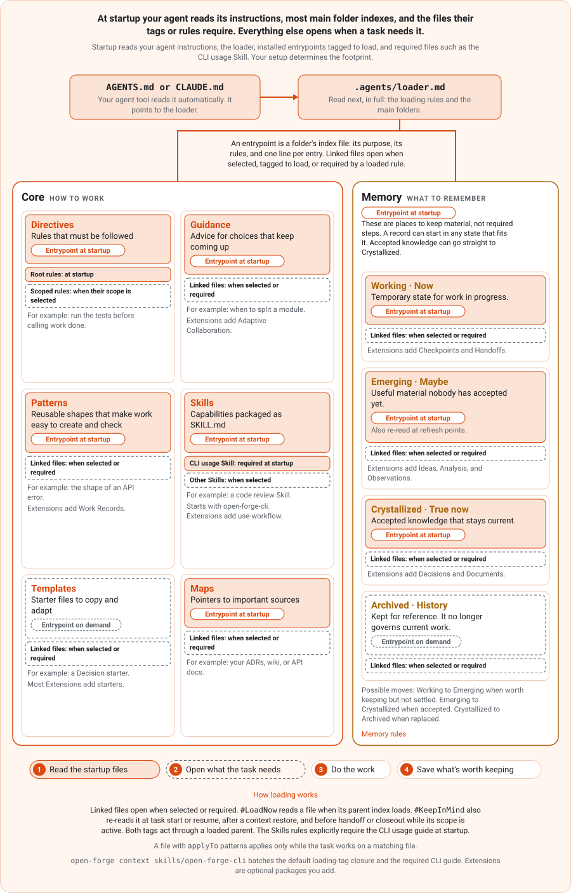

# Open Forge

Open Forge helps coding agents use the rules, docs and decisions your project already has. It's a small Markdown framework: you choose what agents read, when it applies, and which outcomes survive to the next session. The design comes from an idea I call **Adaptive Context Engineering (ACE)**. An agent doesn't need to know everything, but it does need to know where everything is.

Start with one document you already have. Add rules, memory or reusable methods when they solve a problem you actually have. Your documents stay where they are, every part is optional, and so is the CLI.

## Get started

With Node.js 22.18 or later, install the CLI and preview the smallest setup from your project:

```sh
npm install -g @thelithiumforge/open-forge@beta
cd /path/to/your-project
open-forge install --preset minimal --dry-run
```

The plan lists every file it would touch. Minimal writes the loader, a short guide for people in `.agents/README.md`, and a marked Open Forge section in `AGENTS.md` and `CLAUDE.md`. Your existing text in those files stays as it is. Apply the same selection:

```sh
open-forge install --preset minimal --automatic
```

Review the result with `git status` and `git diff`. Nothing is switched on yet.

### Point agents at a document you already have

Add one line under `## Entries` in `.agents/loader.md`, replacing the empty placeholder:

```markdown
- [Contribution rules to follow](../CONTRIBUTING.md) - #LoadNow
```

Use a file that exists in your repository. It stays where it is and needs no frontmatter. `#LoadNow` means agents read it before every task. Add `- applies to` and a pattern in backticks, such as `**/*.cs`, to limit it to matching work, or leave the tag off so agents open it only when its description fits the task. Rules you already wrote for other tools work the same way, such as `../.cursor/rules/testing.mdc` or `../.windsurfrules`.

Now give your agent a normal task:

> Explain how this project runs its tests. Follow `AGENTS.md`, and name the files you read.

Check the answer against your contribution guide. You can stop here.

### Add a rule and an accepted fact

You don't need any Open Forge folders for this. Say your agent keeps calling export work done without running the tests. Create `docs/agent-rules.md`:

```markdown
# Export rules

## Instructions

- When changing CSV exports, run the export tests before reporting completion. Include the command and its result. If the tests cannot run, say why.
```

Once your team has settled that exports use UTF-8, write it down in `docs/export-format.md`:

```markdown
# Export format

CSV exports use UTF-8.
```

Reading a file doesn't make it accepted, so record the authority you're giving it, outside the marked section in `AGENTS.md`:

```markdown
Use docs/export-format.md as the accepted source for CSV export encoding.
```

Then link both, limited to export work:

```markdown
- [Required behavior for export changes](../docs/agent-rules.md) - #LoadNow - applies to `src/export/**`
- [Accepted CSV export encoding](../docs/export-format.md) - #LoadNow - applies to `src/export/**`
```

An export task now reads the rule and the format before it starts. Other tasks don't.

### Give rules and knowledge their own folders

When you want dedicated places for new rules and accepted knowledge, add only those parts:

```sh
open-forge install --configure --preset custom --route directives=add --route memory/crystallized=add --dry-run
```

Review the plan, then run the same command with `--automatic` instead of `--dry-run`. Directives hold rules agents must follow. Crystallized Memory holds accepted knowledge that stays current. Your linked documents stay linked.

### Keep unfinished work across sessions

Add Working Memory when work needs to survive a pause:

```sh
open-forge install --configure --preset custom --route memory/working=git-ignore --dry-run
```

`git-ignore` keeps the records on your machine and still shares the folder's catalogue. The saving policy, `.agents/memory/saving.md`, asks agents to write down the goal, where things stand, the next step and open questions before they pause. Delete that one file if you'd rather save by hand.

## Choose how much to adopt

| You need                                    | Start with                                         |
| ------------------------------------------- | -------------------------------------------------- |
| Agents that use your existing instructions  | Minimal and one document link                      |
| Project rules and accepted facts            | Linked docs, or Directives and Crystallized Memory |
| Work that continues across sessions         | Working Memory and its saving policy               |
| The usual set for a new project             | Essentials                                         |
| Every built-in folder                       | Full Core                                          |
| A particular planning or development method | An [Extension](#extensions)                        |

These are useful stopping points, not steps you must climb. Every folder is optional, and Custom lets you pick each one. Memory states need Memory, but they don't need each other. Extensions declare their own dependencies. To turn a part off, remove its line from the loader. Its files stay as notes, and updates keep it off.

Running `open-forge install` with no options starts a short wizard that offers Essentials, Full Core, Custom and Minimal, with a line on each. The [installation guide](https://thelithiumforge.github.io/open-forge/docs/getting-started/installation) explains every choice and how to change it later. To experiment without touching your checkout, [try it in a separate clone](https://thelithiumforge.github.io/open-forge/docs/getting-started/installation#try-it-and-undo-a-trial).

Starting something new? The [greenfield demo](https://thelithiumforge.github.io/open-forge/docs/demos/greenfield) gives you a first build request, and the [ten-minute guide](https://thelithiumforge.github.io/open-forge/docs/getting-started/ten-minute-guide) walks through adding a rule, keeping a useful fact, and finding the context for your next task. You don't need to choose a workflow, install Extensions, or write a specification first.

<details>
<summary>Other installation methods and setup details</summary>

The CLI is optional. Use a native release without Node.js, build from source, or copy the Framework files manually.

### Install the CLI

#### From npm

The quick start above uses the npm package. It needs Node.js 22.18 or later.

#### From a GitHub release

No Node.js needed. Download `open-forge-<version>-<platform>.tar.gz` from the [releases page](https://github.com/TheLithiumForge/open-forge/releases), where the platform is `linux-x64`, `linux-arm64`, `osx-x64`, `osx-arm64`, `win-x64`, or `win-arm64`. Check it against the release's `SHA256SUMS` and extract it. For example, on Linux:

```sh
sha256sum --check --ignore-missing SHA256SUMS
tar -xzf open-forge-<version>-linux-x64.tar.gz
```

The archive holds a single `open-forge` executable (`open-forge.exe` on Windows) and its license. Put it on your `PATH`, or keep it in your repository, for example as `tools/open-forge`, and run it from there as `./tools/open-forge`.

#### From source

Clone this repository and follow the [local setup guide](docs/development.md#link-the-native-cli-locally) to build and link the CLI.

### Install the Framework

Minimal installs only the loader, the guide for people and the marked host sections, with nothing switched on. Essentials includes Directives, Patterns, Skills, Emerging and Crystallized Memory, plus Working Memory. Full Core includes every built-in folder, and Custom lets you select each one. No preset installs optional Extensions.

Essentials keeps new Working records out of ordinary Git commits and leaves `_working.md` eligible for sharing. Already tracked files stay tracked. Generated `Entries` omit private contents. You can find and read local records with the CLI or your normal file tools.

The CLI selects built-in routes and records what it manages, so it can update those files later. A manual copy supplies Full Core, which you can adapt by hand.

#### With the CLI

From your project (use `./tools/open-forge` instead if you kept the binary in your repository):

```sh
open-forge install --preset essentials --dry-run
open-forge install --preset essentials
```

The dry run previews that exact selection without asking setup questions. Use `minimal` for the smallest setup and `full-core` for every built-in route, and `--frontmatter root` or `--frontmatter scoped` to choose the metadata form without its question. A fresh unattended Install uses root unless settings already declare a preference. An explicit preset or form on an installed workspace also needs `--configure`. For Custom rows and noninteractive configuration, see the [CLI reference](docs/cli.md#setup-choices).

#### Manually, from a clone

No CLI needed. The Framework is complete in [src/open-forge](src/open-forge/). Clone this repository and copy it into your project:

```sh
git clone https://github.com/TheLithiumForge/open-forge.git
cp -R open-forge/src/open-forge/.agents /path/to/your-project/
cat open-forge/src/open-forge/AGENTS.md >> /path/to/your-project/AGENTS.md
```

If your harness reads `CLAUDE.md`, append `open-forge/src/open-forge/CLAUDE.md` to your project's `CLAUDE.md` as well. If the project already has a `.agents/` folder, merge the two by hand instead of copying over it. For the smallest setup, copy only `.agents/loader.md` and `.agents/README.md`, and replace the loader's `Entries` with `- none - No entries - #Empty` before you add your own links.

### After installing

Whichever route you took, review the result with `git status` and `git diff`, then commit it. A fresh install adds new files, which `git status` lists and `git diff` alone doesn't show. That's the whole setup. Installing and updating are things you do when maintaining the workspace. Agents don't repeat them at startup.

If your agent tool does not read `AGENTS.md` on its own, ask it to read that file first. Then give your agent a real task. It starts at `AGENTS.md`, reads the loader and the entrypoints marked for startup, then opens only the routes relevant to the task and works within their rules. You don't need a spec up front. Start with the request and add detail as the work calls for it.

Adding it to an existing codebase? Start with Minimal and link the documents you already have, as shown above. Record Decisions (from the Planning Extension) starting with your next change if you want their reasons kept. Choices made before you adopted Open Forge don't need to become Decisions after the fact, but every change from now on can keep its reasons. The [new or existing project guide](https://thelithiumforge.github.io/open-forge/docs/getting-started/greenfield-and-brownfield) covers both cases, and the [demos](demos/) let you try each one.

</details>

## How it works

```text
You ask for a task
        |
AGENTS.md -> loader
        |
Startup rules + relevant links
        |
Work, keep useful outcomes
```

An agent doesn't need to know everything, but it does need to know where everything is. Each context folder has an `entrypoint`, a short Markdown file that lists what's inside. Startup reads the loader and the entrypoints tagged to load, plus the files their tags or rules require. The rest opens when a task needs it. Scopes keep specialized context with the work it applies to.

I call this **Adaptive Context Engineering (ACE)**. It takes progressive disclosure and spec-driven development and applies them to the workspace itself. Start with what you want to achieve, add detail as the work unfolds, and keep what's worth knowing next time.

Full Core supplies 21 Markdown files, including a guide for people, the saving policy, and four supporting CLI guides that are opened when needed. Essentials installs fewer categories, and Custom follows your selection. Startup reads the installed entrypoints tagged to load and the files their rules require. The files work on their own. The optional CLI speeds up maintenance.

I built Open Forge to work beside your harness, the tool that runs your agent. Anything that reads `AGENTS.md` (or the `CLAUDE.md` bridge) can use it. Keep your hooks, custom agents, and tools. If you want to define them once for several harnesses, a translator such as [APM](https://github.com/microsoft/apm) can install them where each harness looks for them.

## What you get

This is the Full Core inventory. Essentials omits Guidance, Maps, Templates, and Archived Memory. Minimal keeps only `AGENTS.md`, `CLAUDE.md`, the loader and the guide for people. Custom follows your selection. No preset installs optional Extensions.

```text
AGENTS.md                         <- tells the agent to read the loader first
CLAUDE.md                         <- bridge for harnesses that read CLAUDE.md
.agents/
  loader.md                       <- the reading steps and the list of what is on
  README.md                       <- how to customize this setup, for people
  directives/_directives.md       <- required behavior
  guidance/_guidance.md           <- advice for recurring choices
  patterns/_patterns.md           <- reusable shapes for code, files, and documents
  skills/_skills.md               <- native SKILL.md capabilities
  skills/open-forge-cli/SKILL.md  <- how to use the CLI, read before CLI commands
  skills/open-forge-cli/references/
    discovery.md                  <- reading and discovery
    routes.md                     <- route maintenance
    packages.md                   <- Framework and packages
    common.md                     <- shared options and results
  templates/_templates.md         <- copy-ready starting files
  maps/_maps.md                   <- pointers to important local and external sources
  memory/
    _memory.md                    <- what is worth remembering
    saving.md                     <- save progress before pausing, needs Working
    working/_working.md           <- temporary state for active work
    emerging/_emerging.md         <- useful, but not settled yet
    crystallized/_crystallized.md <- accepted knowledge that stays current
    archived/_archived.md         <- history that no longer governs current work
```

Each installed entrypoint says what its category is for and the rules for using it, then lists what's inside under `Entries`. Apart from Memory state entrypoints and the `open-forge-cli` Skill, every selected category starts empty. The content comes from your work, or from Extensions you choose.

In Full Core, startup reads `AGENTS.md`, the loader, Directives, Memory, Crystallized, Emerging and Working Memory, and the saving policy. Guidance, Maps, Patterns, Skills, Templates and Archived Memory open when a task fits their description, and the CLI guide before any CLI command other than `context`. Other linked files open when selected, tagged to load, or explicitly required by a loaded rule. Essentials and Custom use the same loading rules for the routes present. Git-ignored Working records stay readable on your machine, but generated `Entries` leave them out.

Read these files once now, and again after each update. They're short, and they become the instructions your agents are asked to follow.

They're also yours. Add, adapt, replace, or remove the defaults as your needs change. A removed default stays removed unless you ask to restore it.

Use `install --configure` to change the selected defaults later. Custom's Remove choice keeps existing files and notes routable while releasing their Framework management. Explicit configuration can restore eligible missing packaged scaffolding after a checkout, but missing private records need your own copy or backup. The [growth guide](https://thelithiumforge.github.io/open-forge/docs/getting-started/grow-your-framework) covers changing choices and adding one omitted category.

To change just the metadata form, preview `open-forge install --configure --frontmatter scoped --dry-run`, then run it without `--dry-run`. Route choices stay the same. Configure converts unedited owned files, keeps and reports edited files or Extension files whose source is unavailable, and leaves user-authored files, Library files, exclusions, and overwrite companions untouched. Ordinary repeated Install and Update keep your selected form and never ask again.

Edit a shipped file directly when you want a different version. Keep in mind that `open-forge update` brings changed Framework files back to the current version and reports each one it replaces. For a local change that should survive updates, put it in an adjacent `{name}.overwrite.md` instead. It loads right after its base file and shares that file's role, scope, and loading behavior. Where the two answer the same question, the overwrite wins, and updates leave it alone.

## Grow your own framework

Say your agent keeps calling work done without running the tests. This example needs Directives, which Essentials and Full Core include. If Custom left it out, preview and restore its packaged files first:

```sh
open-forge route init directives --framework --dry-run
open-forge route init directives --framework
```

If an ancestor has an explicit exclusion, restore it first as the [CLI reference](docs/cli.md#route-init) explains. Then create `.agents/directives/testing.md`:

Choose root fields or an `open-forge:` mapping for your workspace. Both are readable in every workspace. New files follow `.agents/open-forge.json`. A missing `frontmatter` setting means scoped.

Root form:

```md
---
description: Run the tests before calling a change done
tags: [LoadNow, Directive, Testing]
---

# Testing

## Instructions

- Run the test suite before reporting a change as done, and include the result.
```

Scoped form:

```md
---
open-forge:
  description: Run the tests before calling a change done
  tags: [LoadNow, Directive, Testing]
---

# Testing

## Instructions

- Run the test suite before reporting a change as done, and include the result.
```

Then run `open-forge index`, or replace the `none` placeholder under `Entries` in `.agents/directives/_directives.md` with the line it would generate:

```md
- [Run the tests before calling a change done](testing.md) - #LoadNow #Directive #Testing
```

A Directive at the root of `directives/` must carry `LoadNow`, which tells the agent to read it at the start of every task.

The same move works for everything your project keeps teaching you:

- A correction you keep repeating can become a Directive, or Guidance if it's advice rather than a rule.
- A structure that makes mistakes easy to spot can become a Pattern or a Template.
- A method worth repeating can become a workflow recipe behind the `use-workflow` Skill, from the Workflow Support Extension.
- A specialized capability can become a Skill.
- A useful finding or an accepted decision can become Memory that later work builds on.

**Scopes keep this growth cheap.** Put frontend conventions in a frontend scope and database rules in a database scope. A task selects the branches it needs, and a task that spans both follows both on purpose. Each scope holds only what helps there. There's no fixed limit on how many scopes you add or how deep they go. Active context follows the selected routes and their links, so adding knowledge doesn't mean every task reads more of it.

You can also create plain Markdown notes inside routed folders. Preview `open-forge index --dry-run`, then run `open-forge index` to fill missing metadata and navigation files. After renames or moves, preview and apply `open-forge repair --automatic`. It repairs proven links and affected Entries. Follow Doctor for remaining choices or edits. Links to existing workspace folders are valid too. See [manual edits](docs/cli.md#after-you-edit-files-by-hand).

## Why it works this way

ACE combines two ideas that already work well:

- **Progressive disclosure:** show the next useful level of detail, not everything at once.
- **Spec-driven development:** make goals, constraints, and expected results explicit enough to guide the work and check the result.

ACE applies both to the workspace itself. A task starts from what you want to achieve. As the work unfolds, the agent pulls in what it needs, such as the relevant architecture, your local conventions, or the decision you made last month, and unrelated history stays out. What you learn along the way can become part of the framework, so the next task starts from a better place. Context isn't every file in the repository. It's the knowledge, rules, and current state a task actually needs.

It's plain Markdown on purpose. AI made code cheap to write, and review became the bottleneck, so the framework you work in should be easy to read, diff, and version with the rest of your project. There's no hidden database, no agent runtime, and nothing specific to one vendor.

It's small on purpose too. Big predefined methodologies assume everyone works the same way, and nobody does. My use cases differ from yours, and yours differ from the next person's. Open Forge gives you a handful of rules and a structure that scales, then leaves the rest to you.

That's also why the base stays small and specialized capabilities live in Extensions. Core and Memory cover what every workspace needs: routing, loading, a few content roles, and a place to remember things. Methods for planning, development, project documents, or coordinating several agents are optional packages. You install the ones that fit your work and skip the rest. Once installed, an Extension is just more files in your workspace, and you can adapt it like anything else.

It also works with a mix of agents and tools. Each tool keeps its own interface, and the Framework gives their shared context a place to live. Development is its proving ground, not its boundary. The same structure can support research, design, operations, a personal knowledge vault, or several projects managed together.

## What goes where

The Framework has two parts. **Core** defines routing, loading, and a few reusable content roles. **Memory** keeps useful context as the work evolves.

<details>
<summary>See the full framework map</summary>

<p align="center">
  <picture>
    <source media="(prefers-color-scheme: dark)" srcset="src/docusaurus/static/img/framework-map-dark.svg">
    
  </picture>
</p>

The [loading guide](https://thelithiumforge.github.io/open-forge/docs/concepts/loading-and-tags) explains the loading tags and file conditions step by step.

</details>

Each Core category answers one question:

| Category                                                       | Question it answers                                                         |
| -------------------------------------------------------------- | --------------------------------------------------------------------------- |
| [Directives](src/open-forge/.agents/directives/_directives.md) | What behavior is required in this scope?                                    |
| [Guidance](src/open-forge/.agents/guidance/_guidance.md)       | What approach is recommended, and when does it fit?                         |
| [Patterns](src/open-forge/.agents/patterns/_patterns.md)       | What reusable shape makes related work easy to create and inspect?          |
| [Skills](src/open-forge/.agents/skills/_skills.md)             | Which specialized capability would help with this work?                     |
| [Templates](src/open-forge/.agents/templates/_templates.md)    | What starting content can be copied, adapted, and maintained independently? |
| [Maps](src/open-forge/.agents/maps/_maps.md)                   | Where is a useful local or external source, and when should it be used?     |

Patterns show what related work should look like: a concrete example, tree, table, diagram, or annotated outline you can hold against real code or files. Brief notes explain when it applies, which parts are required, optional or repeatable, how they nest and relate, and which names, values and orders are fixed or illustrative. Link related rules, advice, maps, procedures, and starting files, identify which sources bind the shape, and link back from sources that use it. A review reports justified adaptations as departures, separately from conformance.

A Skill provides a specialized capability through its native `SKILL.md` package. Repeatable methods aren't a Core category. The optional Workflow Support Extension adds a `use-workflow` Skill whose catalogue holds them. Combine whatever suits the work.

[Memory](src/open-forge/.agents/memory/_memory.md) asks: **What is worth remembering for current or future work?** Its default states separate temporary context, unsettled findings, accepted knowledge, and history:

| State                                                                       | Question it answers                                                         |
| --------------------------------------------------------------------------- | --------------------------------------------------------------------------- |
| [Working](src/open-forge/.agents/memory/working/_working.md)                | What temporary context is needed to continue or resume this work?           |
| [Emerging](src/open-forge/.agents/memory/emerging/_emerging.md)             | What is useful but still unsettled?                                         |
| [Crystallized](src/open-forge/.agents/memory/crystallized/_crystallized.md) | What accepted knowledge should remain current within this scope?            |
| [Archived](src/open-forge/.agents/memory/archived/_archived.md)             | What useful history should remain available without governing current work? |

Records move between states as their usefulness changes, and they don't have to pass through every state. People and agents save findings, review them, merge related knowledge, and retire what's no longer needed.

The base ships only the four state entrypoints. Extensions add named categories inside them, for example Checkpoints and Decisions from Planning, Documents from Project Documents, and Handoffs from Observations and Handoffs. Without them, records can live directly under a state.

One rule keeps this from turning into a pile of notes: each source defines only its own part of the truth. A Decision records what was chosen and why. A current document explains its subject as it is now. Required behavior belongs in Directives or inherited [Axioms](https://thelithiumforge.github.io/open-forge/docs/glossary), the required rules from the loader or a loaded entrypoint. Writing an instruction into Memory doesn't make it a Directive. When something is accepted, update the source that defines it and keep the useful reasoning in Memory.

## Frontmatter and tags

Routed Markdown files carry a little frontmatter to help readers, human or agent, decide what to open and what belongs where.

Choose root fields or an `open-forge:` mapping for your workspace. Both are readable in every workspace. New files follow `.agents/open-forge.json`. A missing `frontmatter` setting means scoped.

Root form:

```yaml
---
description: C# rules
tags: [Directive, LoadNow]
applyTo: ["**/*.cs"]
---
```

Scoped form:

```yaml
---
open-forge:
  description: C# rules
  tags: [Directive, LoadNow]
  applyTo: ["**/*.cs"]
---
```

When an `open-forge` mapping exists, root descriptions and tags belong to another tool. Open Forge does not merge them. `applyTo` is read at both locations, with equivalent sets counting once and conflicting sets rejected.

The same precedence applies to `responsibility`. Root metadata alone doesn't make a file a routed source. Native `SKILL.md` keeps its own metadata contract. `route update` edits existing metadata where it was authored, while new metadata follows the workspace setting.

The **description** helps a reader decide whether to open the file. The optional **responsibility** helps an editor decide what belongs in it. Tags help with selection and search, and a few of them have defined behavior:

| Tag                           | Meaning                                                                                                                      |
| ----------------------------- | ---------------------------------------------------------------------------------------------------------------------------- |
| `LoadNow`                     | Read the linked file when its loaded parent lists it                                                                         |
| `KeepInMind`                  | Read it when its parent loads, then again at task start or resume, after context restoration, and before handoff or closeout |
| `Contextual`                  | Treat useful context as unaccepted unless applicable authority establishes acceptance                                        |
| `CurrentTruth`                | Identify accepted current state within its stated scope                                                                      |
| `Evergreen`                   | Keep the content aligned with the current state it represents                                                                |
| `Core`, `Memory`, `Extension` | Identify the part of the Framework or package the content relates to                                                         |

Tags don't grant authority. Loading tags act only through a parent that is already loaded, so they can't pull in a scope nobody selected. Any other tag is yours to describe your own subjects, and it adds no loading behavior.

A file can also list `applyTo` patterns, such as `["**/*.cs"]`. The patterns only filter: a tagged or selected file applies only while the task works on a matching file. [Loading and tags](src/docusaurus/docs/concepts/loading-and-tags.md#file-conditions) has the details.

Each routed folder has an **entrypoint**, normally `_{folder-name}.md`, with short links under `Entries`. Those links are the next choices an agent can make. Reading an entrypoint doesn't open the files it links to. The [loader](src/open-forge/.agents/loader.md) has the complete routing and tag rules, and the [Markdown reference](.agents/memory/crystallized/documents/framework/markdown/syntax.md#frontmatter) covers the format.

## The CLI

The CLI is an accelerant, not a requirement. Everything it does, you can do by editing files. It speeds up the repetitive parts, such as finding context, keeping navigation correct, and updating the Framework, and it shows planned changes before it writes them.

| When you want to                             | Run                                                | Because                                                                           |
| -------------------------------------------- | -------------------------------------------------- | --------------------------------------------------------------------------------- |
| See the tag-selected startup routes          | `open-forge context`                               | You can confirm a new rule is set to load before blaming the model                |
| Find what the workspace already knows        | `open-forge find --tag=Decision`                   | An existing Decision is better reused than made again                             |
| Add a scope or a record                      | `open-forge route init`, `open-forge route create` | Frontmatter and navigation are right from the start                               |
| Complete metadata and navigation after edits | `open-forge index`                                 | Entries are how agents find things, so stale ones hide knowledge                  |
| Check that everything still fits             | `open-forge status`, `open-forge doctor`           | Broken links and stale navigation show up before they mislead an agent            |
| Pick up a new Framework version              | `open-forge update --dry-run`                      | Every file it would replace is listed, so local edits are never replaced silently |
| Remove a default for good                    | `open-forge remove <path> --dry-run`               | Later updates respect the removal                                                 |

Commands that change files offer `--dry-run`, so you see the plan before anything is written.

The flags you'll reach for most often are:

| Flag                                   | Use it to                                                                           |
| -------------------------------------- | ----------------------------------------------------------------------------------- |
| `--dry-run`                            | Preview a change                                                                    |
| `--workspace <path>`                   | Choose a project without changing directories                                       |
| `--detail standard` or `--detail full` | See more reasons and evidence                                                       |
| `--format json`                        | Return structured output for a script or agent                                      |
| `--automatic`                          | Skip confirmation on commands that support it, after reviewing the plan             |
| `--for <path>`                         | Supply working files to `context`, `find`, or `route inspect`. Repeat for each file |
| `--help`                               | See the selected command's arguments and flags                                      |

`--automatic` adds no permission to overwrite or delete files. The [CLI overview](https://thelithiumforge.github.io/open-forge/docs/cli#which-command-for-which-job) lists every command's flags in one place.

Your agent can use it too. The Skills entrypoint requires the `open-forge-cli` usage guide at startup. It links to command details and common options, including batching initial reads with `open-forge context skills/open-forge-cli`. The loader and Skill are plain instructions a harness can read with its usual file tools.

[Working with the CLI](https://thelithiumforge.github.io/open-forge/docs/cli) walks through these flows and when each one helps, and the [CLI reference](docs/cli.md) covers every command and option.

### Without the CLI

Follow the links, edit the files, and keep each `Entries` list in step with the files it points to. That's all the Framework itself needs.

The Framework explains itself through its own files. This README and the guides are here to help you get acquainted. The rules you need to understand and use Open Forge live in the files themselves.

## Extensions

Extensions are optional packages of content you can install and then adapt. The [first-party catalogue](src/extensions/README.md) has the full details and dependencies:

| Package                   | What it's for                                                                                           |
| ------------------------- | ------------------------------------------------------------------------------------------------------- |
| Core Templates            | Starting files for your own Directives, Guidance, Patterns, Skills, Templates, Maps, and Memory records |
| Collaboration             | Exploring ideas, comparing alternatives, and clarifying decisions through discussion                    |
| Project Documents         | Vision, architecture, principles, and other current project documentation                               |
| Planning                  | Ideas, analysis, decisions, tasks, plans, backlogs, and checkpoints                                     |
| Flows and Scenarios       | User journeys, expected outcomes, and records of what happened when they were tried                     |
| Observations and Handoffs | Saving observations and leaving a clear snapshot for whoever resumes the work                           |
| Development               | Implementing, debugging, and reviewing with the project's existing tools                                |
| Task Coordination         | Coordinating related tasks, their dependencies, and the combined result                                 |
| Workflow Support          | Finding and following installed workflows through the `use-workflow` Skill                              |
| Development Toolkit       | Installing Project Documents, Planning, Flows and Scenarios, and Development together                   |

Each package is included because it helps an agent do something it wouldn't reliably do on its own: a method that changes the outcome, a record that keeps what would otherwise be lost, or a starter that makes the right shape obvious. The packages are split the way people choose them, so you install what helps and nothing else.

Not sure where to start? On an existing codebase, start with **Planning** for its Decisions, which keep the reasons behind changes. To write your own rules, start with **Core Templates**. **Development Toolkit** installs Project Documents, Planning, Flows and Scenarios, and Development together. Task Coordination stays outside the Toolkit. Choose it when you coordinate several related tasks and need to verify their combined result.

An Extension is a way to ship files. Routed files take on the meaning of the route they're installed into. Native files, such as a `SKILL.md`, follow the tool that uses them. Packaging adds no authority.

The [Extensions section of the site](https://thelithiumforge.github.io/open-forge/docs/extensions) explains what every package installs and why, and the [Extension guide](docs/extensions.md) covers installing a package, copying its files by hand, and creating your own.

### The document flow

Project Documents and Planning together add an opinionated flow for project knowledge. A Decision records a change: what was chosen, and why. When you accept it, the rules ask for the documents it affects to be updated to say what's true now. The document links to the Decision for the reason, and the Decision links to the document for the result.

Documents are kept top-down:

```text
Vision                        why it exists, for whom, what the first version does
└─ Architecture               the parts, what each owns, the rules they all keep
   └─ component docs, scenarios   exact behavior and expected results
      └─ code and tests

Decisions sit beside the stack and link to the level that holds their result.
```

Top-level documents give an overview of the whole and summarize the narrower documents they link to. Each narrower document explains its own part in more detail and links back up. When a change lands in the detail, the rules ask for the summaries above it to be updated too, so the top keeps giving the current picture. The current answer is one read away, and the reason behind it is one link away.

This flow is the Extensions' opinion, not Core's. Core only asks that detail live in the narrowest source that defines it, and Memory's states work the same without it. [The document flow](https://thelithiumforge.github.io/open-forge/docs/extensions/document-flow) walks through an example.

## What Open Forge doesn't do

Some limits to know before you adopt it:

- **It doesn't make a model deterministic.** Open Forge makes the right context cheap to find and the rules explicit. An agent can still misread or skip them, so review stays with you.
- **It depends on your harness reading `AGENTS.md`** (or `CLAUDE.md` through the bridge). Everything starts there.
- **It isn't a methodology.** There's no mandatory workflow, role, or ceremony. Extensions offer methods, but installing one doesn't make its methods required.
- **It doesn't record everything.** Memory holds what's worth keeping, and the rules ask agents to save outcomes deliberately rather than log every conversation.

## Go deeper

- [Documentation site](https://thelithiumforge.github.io/open-forge/): getting started, concepts, and a file-by-file tour of every Extension.
- [Demos](demos/): try Open Forge on a new project and on a half-built one, with checks for the result.
- [CLI reference](docs/cli.md): every command, option, status, and exit code.
- [Extension guide](docs/extensions.md): packages, dependencies, and customization.
- [Development guide](docs/development.md): local setup, contributions, and verification.

This repository uses Open Forge to build Open Forge, so its own documents double as a working example: [Vision](.agents/memory/crystallized/documents/vision.md), [Principles](.agents/memory/crystallized/documents/principles.md), [Framework Architecture](.agents/memory/crystallized/documents/framework/architecture.md), [Memory](.agents/memory/crystallized/documents/framework/memory/model.md), and the [writing guides](.agents/memory/crystallized/documents/maintenance/writing.md#choose-the-voice).

[MIT license](LICENSE).
